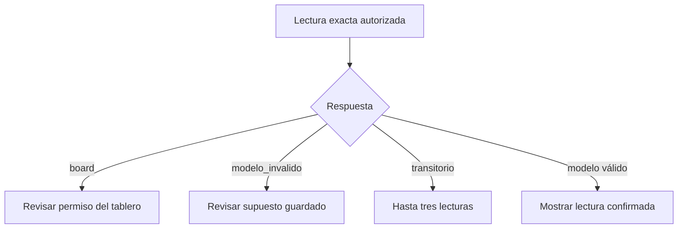

# Diagnóstico de apertura PPP

Propuesta CHG-PPP-READ-VALIDATION-20261029. Fuente frontend: bfd0208ce06d7d73e575d0eeeb66c111658da51a. Copia aislada; no acredita publicación ni apertura productiva. Componentes SYS-POTENCIALES, GAS-PORTERO y SVC-AUTON-CLOUD, conexión CON-019.

El lector exacto conserva la autoridad de Portero y del libro. La interfaz distingue rechazo de tablero, validación del modelo, fallo del servidor, espera agotada y fallo de transporte. Un error genérico servidor no prueba que la red fallara. Las validaciones tipadas admiten exclusivamente code/field_id/scenario_id/reason; no contienen cantidades, límites, fórmulas, credenciales ni detalles internos.

Los errores board y modelo_invalido detienen el reintento automático; reconectar permanece como lectura manual del mismo caso. La sesión y las cantidades se conservan. Una respuesta tardía o de otro caso no puede aplicarse.

La causa financiera no se resuelve con este aviso. Los rangos, la condición de campo inactivo y el origen de una cantidad invalidada deben conciliarse con la fuente canónica antes de modificar datos o validadores. PR47 (ficha/etapas) queda fuera.

Pruebas: apertura exacta, tipos y privacidad de errores, distinción HTTP/servidor/red/timeout, reintento manual tras validación, autorización y descarte de tardíos. Reversión: sólo frontend de apertura, sin tocar registros ni fórmulas.

## Campo no aplicado en valuación por m²

Contrato propuesto del servidor: estado.inactive_fields contiene únicamente inCapRateMercado cuando el input cap es exactamente cero, inValorM2Zona es positivo, estado.porM2 es true y estado.p.capMercado es cero. El cliente exige las cuatro condiciones y rechaza marcadores ajenos, duplicados o inconsistentes. No rellena una tasa. Tarjetas y editor indican «No aplicado: valuación por m²», conservando el cero original en el modelo y el rango de escritura de Campos. Un cero sin ese contrato sigue siendo inválido. Cálculos y cantidades no cambian.

La propuesta central es `2026-10-29.ppp-read-validation.1`; el atlas está fijado en `76bf0fe5c415c29b84aada6a8721c6fc1f8bfc88` (PR326; integrar antes del consumidor). El puente conserva metadata.inactive_fields y transporta results.porM2/results.capMercado desde el mismo estado, sin calcular. La tasa de entrada permanece percent y el resultado nativo ratio.

Validación local: 51 pruebas de apertura/loader/Store/tarjetas/puente; sintaxis de JavaScript y scripts inline del HTML. CI pendiente: el recorrido existente ppp-case-opening-browser.cjs incluye Chromium/WebKit,1280/390px, error de tablero y validación tipada sin reintento automático, reconexión y presentación del cap no aplicado en tarjetas y tablero. Las capturas sintéticas se guardan en el artefacto ppp-interfaz-sintetica. No se dispone de Chromium local y no se acredita recorrido visual hasta ese CI.
