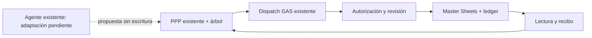

# PPP 4.0 · candidato semilla

Estado: propuesto y en implementación local, no desplegado.

PPP4 incremental: catálogo literal, grafo puro y semilla incompleta versionada dentro del frontend existente. Persistencia propuesta por módulo opt-in en la MISMA implementación GAS y tablas del master. Sin nueva URL, ACL, segundo motor financiero ni datos privados. Seed_id pre-alta es identidad de borrador, no board_case_id; promoción debe preservar vínculo explícito y no se presenta implementada.

## Flujo

## Invariantes y aceptación

- Semilla incompleta preserva null y fuente literal; superficie conocida debe ser positiva. Estado durable requiere recibo y lectura; el grafo distingue cero de ausencia.
- ACL vertical existente, revisión/CAS, repetición/payload mismatch y recuperación por lectura sin segundo POST.
- Catálogo 18 módulos/96 preguntas extraído sin convertir texto en reglas; grafo separa pertenencia y cálculo, rechaza ciclos.
- UI descarta respuesta al cambiar identidad/revisión; propuesta sólo manualmente confirmada; conexión ausente no simula éxito.
- Agente real, promoción a caso, calendario y recorrido online aún requieren integración/QA antes de nivel Básico.

## Reversión

Revertir commits de consumidores y desactivar capacidad semilla en la implementación existente. Preservar semillas, casos, recibos e historia; no borrar ni restaurar libros.

## Abrir el candidato

Desde la raíz de este repositorio, servir los archivos con `python3 -m http.server 8040` y abrir `http://localhost:8040/mixto.html?ppp4=1`. La misma página conserva su entrada habitual cuando no hay parámetros PPP4. El acceso lo controla el Portero existente.

La interfaz sólo habilita guardado si el endpoint existente anuncia esa capacidad. Este cambio de código no instala Apps Script ni activa el flag `PPP40_SEED_ENABLED`; con backend antiguo el guardado permanece deshabilitado. No se utiliza almacenamiento local para fingir persistencia de la semilla.

## Verificación reproducible

- `node --test tests/ppp40-graph.test.cjs tests/ppp40-ui.test.cjs tests/ppp40-bootstrap.test.cjs`
- `node tests/ppp40-browser.cjs` con Playwright instalado y `YOD_ATLAS_DIR` apuntando al checkout del atlas. El transporte sintético y proxy cerrado impiden acceder a servicios de negocio.
- La revisión de la UI cubre dos anchos (1280/390), recibo y lectura, recarga, recuperación sin repetir POST y rechazo inequívoco antes de escribir. Estas pruebas no certifican el backend real.

## Pendientes para la primera versión funcional online

Instalar el candidato revisado en la implementación GAS existente dentro de una ventana coordinada; verificar las protecciones reales y el guardado con un piloto autorizado. Completar la autorización específica de la semilla para el agente existente, la promoción vinculada a un caso y el cálculo nativo de calendario. El catálogo de preguntas es literal: sus dependencias en texto no se ejecutan como reglas de cálculo.
